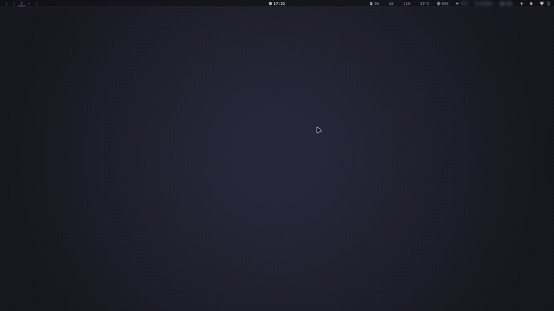

# Hyprland dotfiles

Un escritorio que cambia de personalidad con un atajo. Fondo, colores, barra, bordes, blur, animaciones y shaders de pantalla cambian juntos.



## Qué incluye

- **12 temas listos**, desde cyberpunk y synthwave hasta minimalista y OLED negro total. Cada uno define su fondo, su paleta, el estilo de la barra y los efectos de Hyprland.
- **Paleta generada desde el fondo** con wallust. Los colores llegan a waybar, rofi, kitty, swaync, btop, cava, GTK, el lockscreen y Spotify.
- **Shaders de pantalla** como CRT, VHS, glitch, noir o haze.
- **Overview de ventanas** a pantalla completa (`SUPER+TAB`): ves todas las ventanas del escritorio de un vistazo y elegís con el mouse, las flechas o los números.
- **Selector de temas y fondos** con rofi.

## Temas

| Tema | Estilo de barra |
|---|---|
| Cyberpunk | cyber |
| Synthwave | cyber |
| Tokyo (noche) | flotante |
| Night City | cyber |
| Edgerunner (glitch) | cyber |
| Replicant (neo-noir) | minimal |
| Minimalista | minimal |
| OLED (negro total) | minimal |
| Nebula (neón) | flotante |
| Chill (bosque) | flotante |
| Edgerunners · Luna | flotante |
| Edgerunners · Rebecca | cyber |

Cambiás de tema con `SUPER+T` (menú) o `SUPER+SHIFT+T` (siguiente).

## Requisitos

- EndeavourOS o cualquier Arch-based (el instalador usa `pacman` y `yay`).
- Hyprland. Probado con 0.56.
- Tus propios fondos en `~/Pictures/Wallpapers/` (ver [Fondos](#fondos)).

## Instalación

```bash
git clone git@github.com:BauDahn/hyprland-dotfiles.git ~/dotfiles
~/dotfiles/install.sh
```

`install.sh` instala los paquetes de `packages.txt` y `packages-aur.txt`, enlaza cada carpeta con [GNU stow](https://www.gnu.org/software/stow/) en `$HOME`, compila wallust con cargo si hace falta, pone zsh como shell y configura el tema GTK, los iconos y el cursor. Al terminar, reiniciá la sesión de Hyprland.

## Fondos

Los fondos no están en el repo porque son obras de terceros con copyright. Poné los tuyos en `~/Pictures/Wallpapers/`.

Cada tema busca un archivo concreto, indicado en `WALLPAPER=` dentro de `themes/.config/themes/*.conf`. Por ejemplo, `synthwave.conf` usa `synthwave-1.jpg`. Si querés, podés usar el mismo nombre con tus propias imágenes, o cambiar el valor en el perfil.

## Atajos

| Atajo | Acción |
|---|---|
| `SUPER+Q` | Terminal |
| `SUPER+R` | Launcher |
| `SUPER+B` | Firefox |
| `SUPER+E` | Administrador de archivos |
| `SUPER+C` | Cerrar ventana |
| `SUPER+V` | Alternar flotante |
| `SUPER+TAB` | Overview de ventanas |
| `SUPER+T` | Menú de temas |
| `SUPER+SHIFT+T` | Siguiente tema |
| `SUPER+W` | Menú de fondos |
| `SUPER+SHIFT+W` | Fondo aleatorio |
| `SUPER+CTRL+←/→` | Fondo anterior / siguiente |
| `SUPER+SHIFT+S` | Captura de una región (con edición en swappy) |
| `SUPER+SHIFT+V` | Historial del portapapeles |
| `SUPER+N` | Centro de notificaciones |
| `SUPER+S` | Bloquear y suspender |
| `SUPER+SHIFT+L` | Bloquear |
| `SUPER+L` | ROG Control Center |

Lista completa en `hyprland/.config/hypr/binds.conf`.

## Estructura

Cada carpeta del repo es un paquete de stow y espeja su ruta dentro de `$HOME`. Por ejemplo, `hyprland/.config/hypr/` se enlaza a `~/.config/hypr/`. Editar un archivo en `~/.config` edita el repo.

## Notas

- Pensado para una notebook ASUS ROG. `SUPER+L` abre su control center, así que ese atajo no sirve en otro equipo.
- No hay secretos en el repo. Credenciales y tokens viven en archivos locales ignorados por `.gitignore`.

## Contacto

¿Preguntas, ideas o algo que no funcione? Escribime a bdahcos@upv.edu.es
