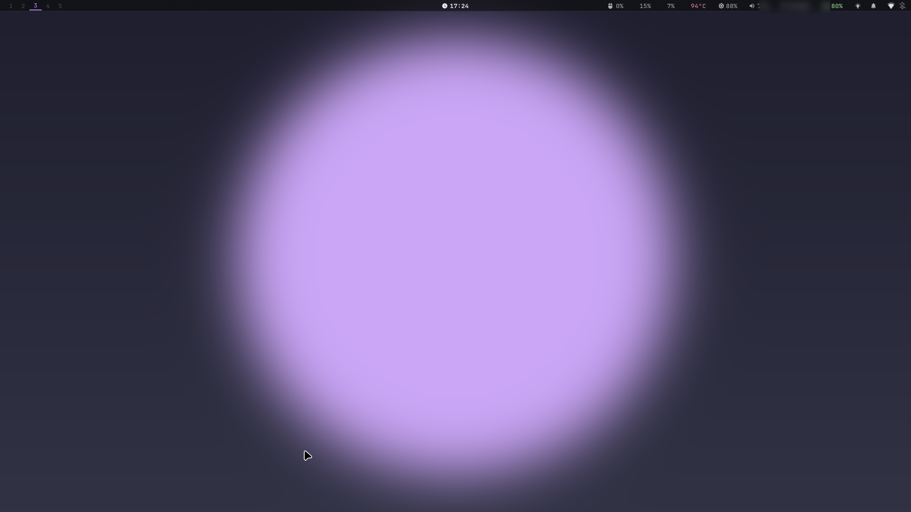

# dotfiles — Hyprland + Catppuccin Mocha (EndeavourOS)

Configuración de escritorio para Hyprland con temas, paleta dinámica (wallust) y shaders de pantalla.

## Demo



Captura con un fondo generado para el ejemplo. Cada tema trae su propio fondo, paleta (wallust), estilo de waybar y efectos de Hyprland.

## Instalación

```bash
git clone git@github.com:BauDahn/hyprland-dotfiles.git ~/dotfiles
~/dotfiles/install.sh
```

`install.sh` instala los paquetes de `packages.txt` (pacman) y `packages-aur.txt` (yay), enlaza cada paquete de configuración con `stow` en `$HOME`, compila `wallust` con cargo si hace falta, pone zsh como shell por defecto y configura el tema GTK. Al terminar, reiniciá la sesión de Hyprland.

## Fondos

Los fondos no están en el repo porque son obras con copyright. Para que los temas funcionen, poné tus propias imágenes en `~/Pictures/Wallpapers/`. Cada perfil en `themes/.config/themes/*.conf` indica el nombre de archivo que espera en la variable `WALLPAPER=`.

## Paquetes stow

`hyprland`, `hyprlock` (incluye hypridle), `waybar`, `kitty`, `rofi`, `swaync`, `cava`, `btop`, `swappy`, `qt`, `overview`, `bash`, `zsh`, `themes`.

Cada `~/.config/*` es un symlink a este repo, así que editar el archivo en `~/.config` edita el repo.

## Temas

- Perfiles en `themes/.config/themes/*.conf` (cyberpunk, nightcity, synthwave, tokyo, moon, etc.).
- `hyprland/.config/hypr/scripts/theme.sh` aplica un perfil: estilo de waybar, márgenes, bordes, blur y animaciones.
- `wallpaper.sh` cambia el fondo y `palette.py` genera la paleta (wallust) para waybar, rofi, kitty, swaync, hypr, btop, cava, GTK y Spotify.
- Shaders de pantalla en `hyprland/.config/hypr/shaders/`.

## Atajos principales

| Atajo | Acción |
|---|---|
| `SUPER+Q` | Terminal |
| `SUPER+R` | Launcher (rofi) |
| `SUPER+B` | Firefox |
| `SUPER+E` | Dolphin |
| `SUPER+C` | Cerrar ventana |
| `SUPER+S` | Bloquear y suspender |
| `SUPER+SHIFT+L` | Bloquear |
| `SUPER+SHIFT+S` | Captura de una región (grim + swappy) |
| `SUPER+SHIFT+V` | Historial del portapapeles (cliphist) |
| `SUPER+N` | Centro de notificaciones (swaync) |
| `SUPER+TAB` | Overview de ventanas a pantalla completa (flechas, click o 1–9 para elegir; Esc cierra) |
| `SUPER+W` | Selector de fondo |
| `SUPER+T` | Selector de tema |
| `SUPER+L` | ROG Control Center (específico de notebooks ASUS ROG) |

Ver `hyprland/.config/hypr/binds.conf` para la lista completa.

## Notas

- Los secretos (credenciales, tokens, claves) no están en el repo. Quedan en archivos locales ignorados por `.gitignore`.
- La configuración de GPU, monitores y entrada (`monitors.conf`, `env.conf`, `input.conf`) es específica de cada equipo. Revisala antes de usarla en otra máquina.

## Contacto

Si querés escribirme: bdahcos@upv.edu.es
